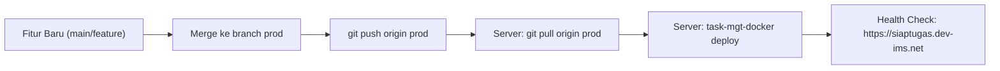

# Standar Prosedur Operasional (SOP) Deployment Server Online

Dokumen ini berisi panduan resmi untuk merilis dan mengunggah pembaruan aplikasi **Kinerja (SiapTugas)** ke server online menggunakan cabang GitHub **`prod`**.

---

## 1. Spesifikasi Server & Lingkungan Produksi

| Parameter | Konfigurasi | Keterangan |
| :--- | :--- | :--- |
| **URL Aplikasi** | [https://siaptugas.dev-ims.net](https://siaptugas.dev-ims.net) | Domain produksi publik |
| **IP Server** | `45.76.154.46` (Vultr) | Server VPS |
| **SSH Port** | `29453` | Port SSH non-standar |
| **DevOps User** | `task_mgt_devops` | User pengelola deployment |
| **SSH Key** | `~/.ssh/task_mgt_devops_ims` | Kunci private autentikasi |
| **Direktori Aplikasi** | `~/task_mgt/app` | Path clone repository di server |
| **Branch Target** | `prod` | Cabang produksi GitHub |
| **Runtime Engine** | Docker Compose + Node.js (Standalone) | Container `task_mgt-app-1` |
| **Database** | PostgreSQL lokal di port `5432` (`task_mgt`) | Database engine server |
| **CLI Helper** | `/usr/local/sbin/task-mgt-docker` | Perintah manajemen kontainer (sudo) |

---

## 2. Alur Kerja Rilis (Deployment Workflow)

Setiap pembaruan fitur yang siap diproduksi harus di-push ke branch **`prod`**, kemudian server akan menarik (`git pull`) perubahan tersebut dan melakukan build ulang container.



---

## 3. Langkah-Langkah Unggah (Step-by-Step)

### Langkah 1: Sinkronkan dan Push ke Branch `prod` dari Lokal

Jalankan perintah berikut di terminal komputer lokal Anda:

```bash
# 1. Pastikan branch prod lokal sinkron dengan remote
git checkout prod
git pull origin prod

# 2. Gabungkan perubahan dari branch kerja (misal: main)
git merge main

# 3. Push pembaruan ke GitHub branch prod
git push origin prod
```

---

### Langkah 2: Deploy ke Server

Anda dapat menjalankan proses pull dan rebuild kontainer secara langsung lewat SSH tanpa perlu login interaktif:

#### Cara Cepat (Satu Perintah dari PowerShell):
```powershell
ssh -i "$env:USERPROFILE\.ssh\task_mgt_devops_ims" -p 29453 task_mgt_devops@45.76.154.46 "cd ~/task_mgt/app && git pull origin prod && sudo /usr/local/sbin/task-mgt-docker deploy"
```

---

### Langkah 3: Migrasi Database (Jika Ada Perubahan Schema Prisma)

Jika perubahan kode Anda menyertakan perubahan pada `prisma/schema.prisma`:
```powershell
ssh -i "$env:USERPROFILE\.ssh\task_mgt_devops_ims" -p 29453 task_mgt_devops@45.76.154.46 "sudo /usr/local/sbin/task-mgt-docker migrate"
```

---

### Langkah 4: Verifikasi Status Aplikasi

Pastikan service berjalan normal dan sehat:
```powershell
ssh -i "$env:USERPROFILE\.ssh\task_mgt_devops_ims" -p 29453 task_mgt_devops@45.76.154.46 "sudo /usr/local/sbin/task-mgt-docker status"
```

Uji respons endpoint kesehatan:
```powershell
ssh -i "$env:USERPROFILE\.ssh\task_mgt_devops_ims" -p 29453 task_mgt_devops@45.76.154.46 "curl -s http://127.0.0.1:3002/api/health"
```

---

## 4. Perintah Pemeliharaan & Troubleshooting

| Kebutuhan | Perintah Remote SSH |
| :--- | :--- |
| **Cek Log Aplikasi** | `sudo /usr/local/sbin/task-mgt-docker logs` |
| **Restart Aplikasi** | `sudo /usr/local/sbin/task-mgt-docker restart` |
| **Hentikan Aplikasi** | `sudo /usr/local/sbin/task-mgt-docker stop` |
| **Jalankan Aplikasi** | `sudo /usr/local/sbin/task-mgt-docker start` |
| **Akses Database CLI** | `psql -h 127.0.0.1 -U task_mgt_devops -d task_mgt` |

---

## 5. Mengakses Database Server dari Komputer Lokal

Buka tunnel SSH port forwarding:
```powershell
ssh -i "$env:USERPROFILE\.ssh\task_mgt_devops_ims" -p 29453 -L 5433:127.0.0.1:5432 task_mgt_devops@45.76.154.46 -N
```

Gunakan koneksi berikut di DBeaver / TablePlus / pgAdmin:
* **Host:** `127.0.0.1`
* **Port:** `5433`
* **Database:** `task_mgt`
* **User:** `task_mgt_devops`

---

## 6. Prosedur Dump & Migrasi Data dari Supabase ke Server

Di server remote, telah tersedia script `~/migrate_supabase.sh` yang secara otomatis:
1. Menonaktifkan Foreign Key sementara.
2. Mengosongkan (TRUNCATE) tabel target.
3. Menyalin seluruh data dari pooler Supabase ke PostgreSQL server dengan pemetaan kolom yang sinkron (`COPY ... TO STDOUT` &rarr; `COPY ... FROM STDIN`).
4. Mengaktifkan kembali seluruh Foreign Key constraints.
5. Menjalankan `ANALYZE` untuk optimasi indeks query.

Jika ingin menjalankan sinkronisasi ulang kapan saja:
```powershell
ssh -i "$env:USERPROFILE\.ssh\task_mgt_devops_ims" -p 29453 task_mgt_devops@45.76.154.46 "bash ~/migrate_supabase.sh"
```

